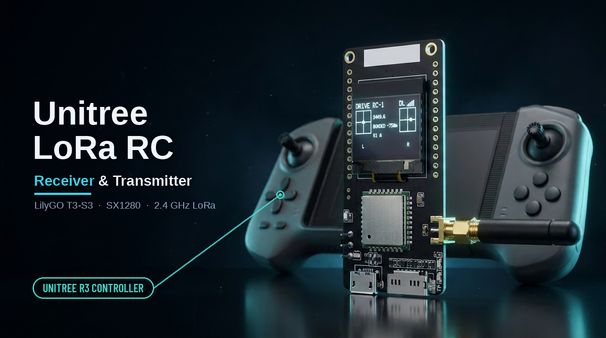

# Unitree LoRa RC Receiver & Transmitter

Turn a **LilyGO T3-S3 (SX1280)** dev board into either end of the 2.4 GHz LoRa link
between a Unitree handheld remote and the robot's RF module. As a
**transmitter** it acts as a remote — a searching robot bonds to the board and obeys the
sticks and buttons you send; as a **receiver** it decodes a real remote's frames live.
The full protocol is documented in [`docs/PROTOCOL.md`](docs/PROTOCOL.md), so both
directions are complete implementations, not packet guesswork.

<p align="center">
  
</p>

> ⚠️ **Use only on hardware you own and are authorized to test.** This drives a
> robot's control link. Keep the robot on a bench/stand, clear of people, and start
> with motion disabled. See [Safety](#safety).

---

## What it does

- **TRANSMIT** (`drive`) — camps on a remote's home channel and beacons the 42-byte
  uplink frame. A robot with no remote bonded locks onto it and acts on the
  sticks/buttons. The robot's downlink (its ACK) is shown as link state + RSSI, like a
  real remote's **DL** LED and signal bars.
- **RECEIVE** — decodes a real remote's uplink (sticks, buttons, checksum), drawn as two
  joysticks on the OLED.
- **CALIBRATE** — measures this board's crystal error against the robot's ACKs and
  stores the correction (see [Crystal calibration](#crystal-calibration)).

All you need is the remote's **printed 6-character ID** — no per-remote capture needed.
The on-air format is documented in [`docs/PROTOCOL.md`](docs/PROTOCOL.md).

## Hardware

| | |
|---|---|
| Board | **[LilyGO T3-S3 with the SX1280 (2.4 GHz LoRa) module](https://www.tinytronics.nl/en/development-boards/microcontroller-boards/with-lora/lilygo-t3-s3-lora-2.4ghz-esp32-s3-sx1280-with-pa-0.96-inch-oled-display)** |
| MCU | ESP32-S3 |
| Radio | Semtech SX1280, SPI |
| Display | onboard SSD1306 128×64 OLED |

Two board details matter and are already handled in firmware:

1. **RF switch (FEM).** The SX1280**PA** variant has a front-end module whose antenna
   switch must be driven (`TX=GPIO10`, `RX=GPIO21`) or **transmit never reaches the
   antenna** — receive works, but nothing is sent. The firmware calls
   `setRfSwitchPins()`; on the plain (non-PA) board those GPIOs are simply unused.
2. **TX power.** On the PA board the FEM turns ~3 dBm into ~20 dBm, and more than a few
   dBm *into* the FEM can damage it. Default power is **3 dBm**. Only raise it (`pwr`)
   on a non-PA board.

Pin map (matches LilyGO's T3-S3 SX1280): `SCK=5 MISO=3 MOSI=6 CS=7 DIO1=9 BUSY=36
RST=8`, OLED `SDA=18 SCL=17`, user LED `37`, BOOT button `0`.

## Quick start

Built with [PlatformIO](https://platformio.org/).

```bash
pio run -t upload          # build + flash
pio device monitor         # 115200 baud serial console
```

The board boots into **RECEIVE** on the first remote profile. Type `help` for all commands.

To transmit as a remote (robot's own remote must be **off** so it searches):

```
drive 1                    # transmit as remote profile 1
stick 0 0.5 0 0            # lx rx ry ly  (floats, -1..+1)
btn 01 00                  # buttons: byte1 byte2 (hex bitmask)
wave on                    # sweep rx as a sine (handy to see the link move)
drivestop
```

## Commands

| group | command | meaning |
|-------|---------|---------|
| remote | `setid <code>` | set the active profile from the remote's printed 6-character code |
| | `rem N` / `next` | select remote profile (BOOT button also cycles) |
| receive | `receive` / `cap` | receive & decode on the current channel |
| | `fscan` / `hunt` | find a beacon / detect a preamble across the band |
| transmit | `drive [N]` | transmit as remote profile N |
| | `stick lx rx ry ly` | set stick axes (live) |
| | `btn h1 h2` | set button bitmasks (live) |
| | `wave on\|off` | sweep rx as a 4 s sine |
| | `gap ms` | beacon period (default 90 ms) |
| | `drivestop` | stop transmitting |
| cal | `calibrate` | auto-measure crystal offset vs the robot's ACKs |
| | `ppm <v>` | set crystal correction by hand |
| | `pwr <dBm>` | TX power (keep ≤3 on a PA board) |
| | `rfsw on\|off` | drive the FEM antenna switch |
| low | `f MHz` `b kHz` `sf N` `p N` | raw radio params |
| | `info` · `help` · `stop` | config · help · idle |

Button bitmasks: byte 1 = `R1 L1 Start Select R2 L2 F1 F2` (bit 0→7), byte 2 =
`A B X Y Up Right Down Left`.

## Crystal calibration

The SX1280 derives every frequency from a **52 MHz reference** and assumes it is exact.
A plain crystal (not a TCXO) is off by tens of ppm, so a commanded 2437.900 MHz can
come out ~120 kHz high and miss the module's narrow receive window. The firmware
corrects this in software (a ppm offset).

`calibrate` re-measures it for *your* board: with the robot searching (its own remote
off), it sweeps the correction and keeps the value where the robot's ACKs are strongest.

```
drive 1
calibrate                  # ~30 s sweep; prints and saves the best ppm
```

The Unitree modules don't need this — they use an accurate (TCXO-grade) reference and run
at exact nominal frequencies. The dev board, with its plain crystal, is the odd one out.

## How it works

Full write-up in [`docs/PROTOCOL.md`](docs/PROTOCOL.md). In short:

- **Identity:** `ID → air_A = (last 3 digits) mod 256`, `air_B = (month + 18·day) mod 256`;
  `channel = 2401.0 + 0.9 · CHAN[n] MHz`, where `n` is the last two ID digits and `CHAN`
  is a fixed 100-entry channel map (see the protocol doc).
- **PHY:** LoRa SF5, BW 406.25 kHz, CR 4/6 long-interleaving, 12-symbol preamble,
  explicit header, hardware CRC, default sync word.
- **Uplink frame (42 B):** `air_A air_B 55 51 <btn1><btn2> <LX f32><RX f32><RY f32> _
  <LY f32> … <checksum>`, checksum = big-endian sum of bytes [4:40].
- **Bond:** a searching robot accepts the first addressed frame with a matching air-id —
  no handshake — and relays it to the body MCU, which publishes `rt/wirelesscontroller`.

## Repository layout

```
src/main.cpp         firmware (receiver + transmitter)
docs/PROTOCOL.md     the link protocol reference
host/                helper scripts (serial decoder, flash)
assets/              README art
platformio.ini       build configuration
```

## Safety

- Only use this on a robot you own and are authorized to control.
- Bench the robot on a stand with motion disabled; transmitted input moves the real robot.
- On a PA board keep TX power at 3 dBm to protect the front end.
- This is for research, interoperability and education on your own equipment.

## License

GPL-2.0 — see [LICENSE](LICENSE). Built with [RadioLib](https://github.com/jgromes/RadioLib)
and [U8g2](https://github.com/olikraus/u8g2).

Unitree is a trademark of its owner; this project is not affiliated with Unitree.

## Support

A big thank you to the **RoboLegion** community! Visit us at [robolegion.com](https://robolegion.com) for more, and come join the discussion on [Discord](https://discord.gg/MHcrVs3JYp).

If you like this project, please consider buying me a coffee:

<a href="https://www.buymeacoffee.com/legion1581" target="_blank"></a>
